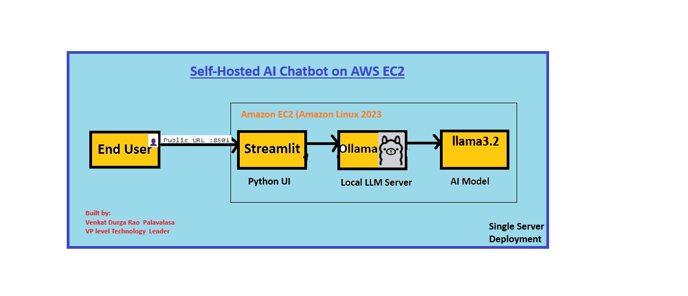

OLLAMA Chat Bot Setup
======================

## Architecture

Architecture Flow
End User → Streamlit UI → Ollama → Llama 3.2

Streamlit provides the web UI. 
Ollama serves the local LLM. 
Llama 3.2 generates responses. 
Hosted on a single AWS EC2 instance running Amazon Linux 2023. 

Step1: Launched Amazon linux from AWS
================================

Step2:  Check default python version in Amazon Linux 2023 
=================================================

$ python3 --version

Step3: Install Git
=============

$ sudo yum install git -y

Step4: Clone the repository
====================

$ git clone https://github.com/VenkatPalavalasa/Ollama-chatbot.git

Step5: Create the virtual environment (named venv)
===========================================

$ python3 -m venv venv

Step6: Activate the virtual environment:
=================================

$ source venv/bin/activate

Step7: Install your requirements inside the virtual environment:
=========================================================

$ sudo yum install python3-pip -y

$ pip install -r requirements.txt

Step8: Run your Application;
=====================

$ streamlit run app.py
